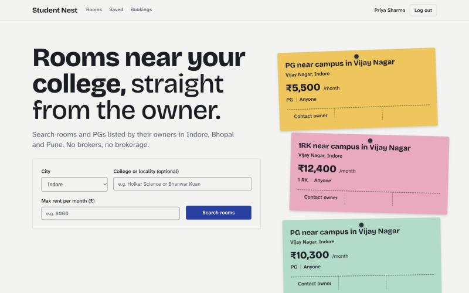
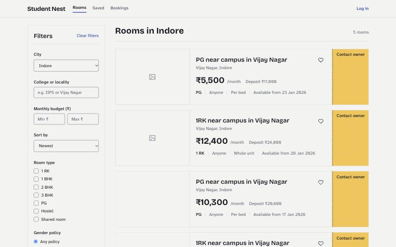
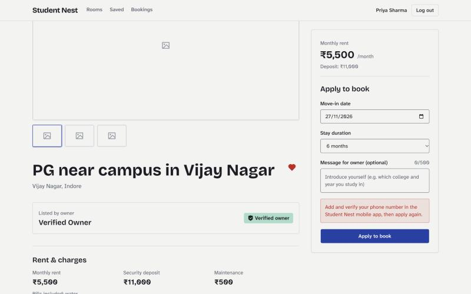
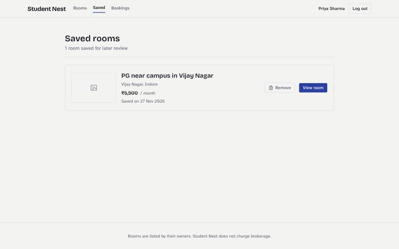
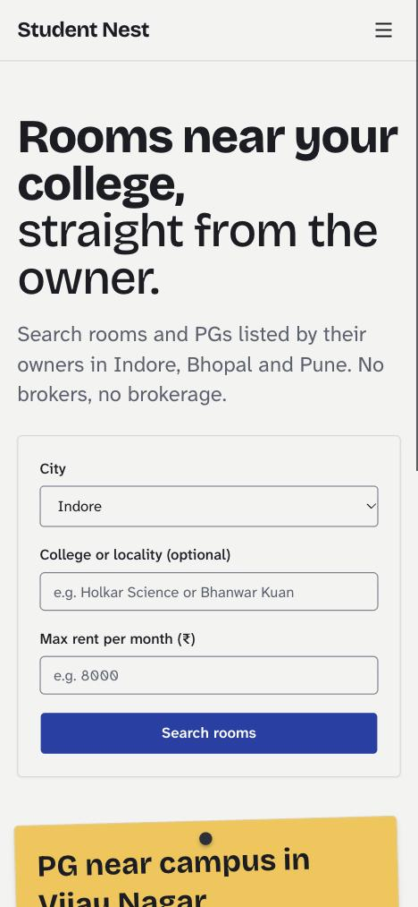
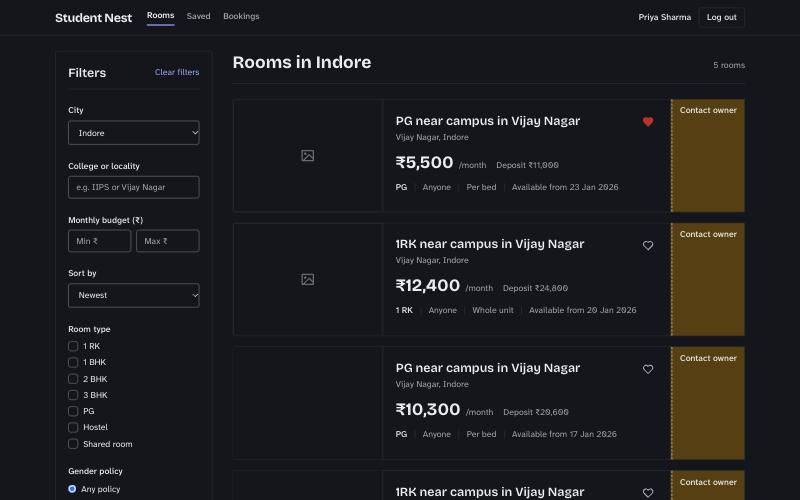
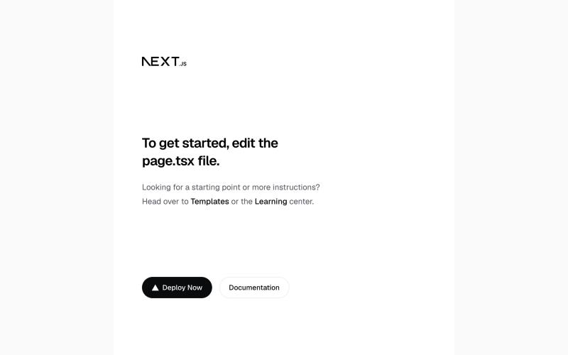

# Student Nest web

Student Nest is a broker-free marketplace where students in Indian cities find rooms and PGs near their college and deal directly with verified owners. This repository contains the Next.js web application for students to search, save, and apply to book listings, and for owners to see the status of their listings.

## Stack

- Next.js 16 (App Router)
- React 19
- TypeScript
- Tailwind CSS 4
- shadcn/ui on Base UI primitives
- Remix Icon via @remixicon/react
- TanStack Query
- Firebase Auth (JS SDK, email OTP via custom tokens)
- openapi-typescript generated API types
- Vitest and Testing Library

## Prerequisites and local setup

1. Run the backend (`student-nest-backend`) on http://localhost:3000 with its Firebase emulators (Auth on localhost:9099, Firestore on 8080, Storage on 9199, project `student-nest-dev`) and seeded data (Indore, Bhopal and Pune listings). The backend's `CORS_ORIGINS` must include `http://localhost:3001`. Search is public, so `/` and `/rooms` work without signing in (`GET /v1/search/rooms` needs a `city` or `near`).
2. Copy the environment configuration:
   ```bash
   cp .env.example .env.local
   ```
3. Install dependencies:
   ```bash
   npm ci
   ```
4. Start the development server:
   ```bash
   npm run dev
   ```
   Open http://localhost:3001 in your browser.

### Signing in locally

The web app signs in with an emailed 6-digit code. With `DEV_OTP_BYPASS=true` in the backend's emulator setup, any email address ending in `@test.studentnest.app` (for example `asha@test.studentnest.app`) accepts the code `000000`, and no email is sent. A new address goes through sign-up, where you pick student or owner and enter your name. This bypass only works against the emulators and is refused in production.

## Environment variables

| Variable | Description | Default |
| --- | --- | --- |
| NEXT_PUBLIC_API_URL | Backend API base URL | http://localhost:3000 |
| NEXT_PUBLIC_FIREBASE_AUTH_EMULATOR_HOST | Host and port for the Firebase Auth emulator; leave empty to use real Firebase Auth | localhost:9099 |
| NEXT_PUBLIC_FIREBASE_PROJECT_ID | Firebase project ID | student-nest-dev |
| NEXT_PUBLIC_FIREBASE_API_KEY | Firebase API key (any non-empty string for the emulator) | any-non-empty-string-for-emulator |

## Scripts

| Script | Description |
| --- | --- |
| `npm run dev` | Start the development server on port 3001 |
| `npm run build` | Build the application for production |
| `npm start` | Start the production server on port 3001 |
| `npm run lint` | Run ESLint code checks |
| `npm run typecheck` | Run TypeScript type checks (`tsc --noEmit`) |
| `npm test` | Run test suite once with Vitest |
| `npm run test:watch` | Run Vitest in interactive watch mode |
| `npm run gen:api` | Regenerate `src/lib/api/schema.d.ts` from `docs/api/openapi.json` (copy the latest `docs/api/openapi.json` from the backend first) |

## Routes

| Route | Description |
| --- | --- |
| `/` | Home page with search form and animated handbill listings |
| `/rooms` | Search results list with URL-synced filters |
| `/rooms/[id]` | Room detail view with save and apply to book actions |
| `/login` | Email code sign-in and sign-up flow |
| `/saved` | Saved rooms list for student accounts |
| `/bookings` | Booking applications list for student accounts |
| `/owner/listings` | Property management for owner accounts |

## Folder overview

```text
docs/
├── api/
│   └── openapi.json          # Copied OpenAPI contract from backend
└── DESIGN.md                 # Visual design system and handbill concept record
src/
├── app/                      # Next.js App Router routes, layouts, and loading/error/not-found boundaries
├── components/
│   ├── handbill/             # Handbill card, tear-off strip, and status chip components
│   ├── rooms/                # Room list row, filters, search form, and detail views
│   ├── site/                 # Shared site header and footer components
│   ├── states/               # Reusable loading skeleton, empty state, and error state components
│   └── ui/                   # Base UI primitives styled with shadcn
└── lib/
    ├── api/                  # Typed fetch client, API error envelope handling, and generated schema
    ├── auth/                 # Auth context, email OTP flow, and role route guards
    ├── firebase.ts           # Firebase SDK client initialization and emulator wiring
    └── search-params.ts      # Search parameter serializing and parsing utilities
```

## Known limitations

- Applying to book (`POST /v1/bookings`) requires a verified phone number. Phone verification (Firebase Phone Auth) is not built in either client yet, so new test accounts get `PHONE_REQUIRED`, which the web app shows as a clear message.
- Owners cannot create or edit listings on the web yet. `/owner/listings` shows the owner's listings and their status only (seeded owners have listings).
- Listing photos are served by the Storage emulator in local development (http://localhost:9199); a missing photo falls back to a placeholder.

## Design

See [docs/DESIGN.md](docs/DESIGN.md) for the complete design system specification, colour tokens, typography scale, and layout guidelines.

## Screenshots

Taken from a local run against the NestJS API and Firebase emulators with seeded data. The seed script does not upload photos, so rooms show the photo placeholder.

| Home | Search results |
| --- | --- |
|  |  |

| Room detail with the apply panel | Saved rooms |
| --- | --- |
|  |  |

| Phone width | Dark mode |
| --- | --- |
|  |  |

Before this refinement the repo was the create-next-app starter page:



An interview and architecture guide is in [`docs/INTERVIEW.md`](docs/INTERVIEW.md).
