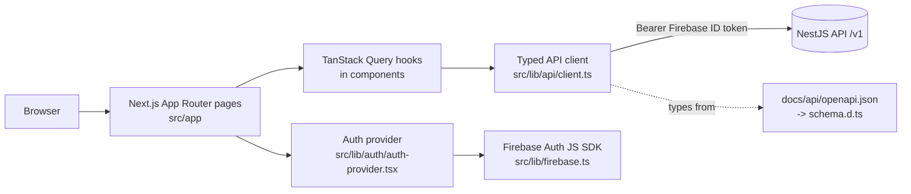

# Student Nest web: interview guide

Plain-English notes for explaining the web client. Facts were checked on 2026-11-27. The backend's own guide (`student-nest-backend/docs/INTERVIEW.md`) covers the API in depth.

## 30-second version

This is the Next.js 16 web app for Student Nest, a broker-free room marketplace for students. You can search rooms by city with filters kept in the URL, open a room, save it and apply to book. You sign in with an emailed code, and owners can see their listings. It talks to a NestJS API using TypeScript types generated from the API's OpenAPI file. The design is based on the "room available" handbills with tear-off strips that you see near college gates.

## 2-minute version

Students searching for a room want to compare rent fast, so the results page is a list where the rent is the biggest thing in each row, not a grid of identical cards. Filters (city, budget, room type, gender policy, amenities, sort) live in the URL. A search can be shared or bookmarked, and the back button works. Typing in a filter updates the URL straight away, but the API is only called once typing pauses for 400 ms, because guests are rate-limited to 60 searches a minute.

Data fetching uses TanStack Query in the browser. The login token only exists there, and the API personalises results (for example whether each room is saved). Each query's cache key includes the signed-in user's id, and queries wait until Firebase has restored the session, so a guest's cached results are never shown to a signed-in user.

Sign-in: enter an email, get a 6-digit code, and the API returns a Firebase custom token. New users then pick "student" or "owner" and give their name. All API errors come back as `{ error: { code, message } }`, and the app maps codes to plain messages.

Design: one idea, the handbill with a tear-off strip, used only on the home page listings and the "Contact owner" strip on each result row. Everything else is quiet: a cool grey "photocopy paper" background, ballpoint-blue actions, Bricolage Grotesque headings, Atkinson Hyperlegible body text. Every text and background pair was contrast-checked against WCAG AA. There's one animation (the three home-page handbills get pinned on), and it's switched off for users who ask for reduced motion.

## Problem and users

Students aged 18–24, mostly on phones, comparing rooms near their college in Indore, Bhopal and Pune. Owners checking the status of their listings.

## Architecture

## One request, screen to database and back: saving a room

1. **Click.** On `/rooms`, the heart in `src/components/rooms/room-row.tsx` flips immediately, an optimistic update.
2. **API call.** `addFavorite(id)` in `src/lib/api/index.ts` calls `PUT /v1/favorites/{id}`. `src/lib/api/client.ts` attaches `Authorization: Bearer <ID token>` from the Firebase user.
3. **Backend.** The API checks the token and the student role. `FavoritesService.add` writes `users/{uid}/favorites/{id}` in a Firestore transaction, so saving twice is harmless. The full trace is in the backend guide.
4. **Response.** On success, the component invalidates the `favorites`, `rooms` and `property` queries, so the Saved page and the room page agree. On failure, the heart flips back and a toast explains the problem.

## Why each main technology, and one alternative

| Choice | Why | Alternative |
| --- | --- | --- |
| Next.js 16 App Router | Routing, metadata, loading and error boundaries per route, production build | Vite + React Router: lighter, but you build those yourself |
| TanStack Query | Caching, retries, pagination and optimistic updates with little code | SWR: smaller, fewer mutation tools |
| openapi-typescript | Types come from the API contract, so a renamed field breaks the build, not production | Hand-written types that drift |
| Firebase Auth JS SDK | The API issues Firebase custom tokens; the SDK refreshes ID tokens | NextAuth: would need its own session layer next to Firebase |
| Tailwind 4 + shadcn (Base UI) | Accessible primitives (dialog, sheet, checkbox) that the project owns | A component library such as MUI: faster start, harder to make distinctive |
| Vitest + Testing Library | Fast tests that share the Vite transform | Jest: also fine, slower setup with ESM |

## Hard problems solved

- **New accounts got stuck.** The API answers `403 PROFILE_REQUIRED` (not 404) for a signed-in user who hasn't finished signup. The app only looked for 404, so new users skipped the "choose role and name" step and every later call failed. Found by running the sign-up flow in a browser against the real API, not by unit tests. Fixed in `src/lib/auth/auth-provider.tsx`, with a test added.
- **Wrong "saved" state.** Room details were fetched before Firebase restored the session, so they were cached as a guest response without `isFavorite`. Fixed by keying queries by user id and waiting for auth.
- **Photo placeholder covered the page.** An absolutely positioned image had no positioned parent on the Saved and owner-listings pages.
- **A shadcn CLI quirk.** Generated components imported `cn` from a separate npm package that ignores the custom Tailwind type scale, silently dropping classes. They were pointed back to the local helper.

## 15 likely interview questions

1. **Why keep filters in the URL?** Shareable links, a working back button, and the page can be rebuilt from the URL alone.
2. **Why debounce the search?** To avoid one API call per keystroke and stay under the guest rate limit. The URL still updates on every keystroke.
3. **Server or client components?** Pages are Server Components that only export metadata. Data is fetched in the browser because the token lives there and results are personalised.
4. **How do you protect pages?** `use-require-auth` sends signed-out users to `/login?next=…`. `safe-next.ts` only allows relative paths, so `next` can't redirect to another site.
5. **What is an optimistic update?** Change the UI first and roll back if the server says no. It makes the heart feel instant.
6. **How do you handle errors?** The API error envelope becomes an `ApiError` with a `code`, and codes map to messages in `src/lib/api/errors.ts`. Network failures get their own message.
7. **How do you keep types in sync with the backend?** Copy `openapi.json` from the backend and run `npm run gen:api`.
8. **How did you make it accessible?**
   - Labelled inputs, with `fieldset` and `legend` for grouped filters.
   - A visible focus ring.
   - Keyboard-operable dialogs.
   - Contrast checked to AA.
   - Reduced motion respected.
9. **Why this visual direction?** It comes from how broker-free renting already works offline. The alternative, a map-first layout, was rejected because it hides the price-first scanning students do and needs map API keys.
10. **How does pagination work?** Cursor-based "Show more rooms" with `useInfiniteQuery`. The API returns `nextCursor` and `hasMore`.
11. **What do you test?** The API client (token header, error envelope, network error), search-param parsing, safe redirects, formatters, the profile-missing check, and three components' states. 33 tests.
12. **How does sign-in work?** Email, then a code, then a custom token, then `signInWithCustomToken`. For new users, `POST /v1/auth/signup` follows and the token is force-refreshed to pick up the role claim.
13. **Why can't users apply to book from the web?** The API requires a verified phone, and phone verification isn't built in either client yet. The app explains this instead of failing silently.
14. **How would you deploy it?** Vercel or any Node host. Set `NEXT_PUBLIC_API_URL` and the Firebase settings, and leave the emulator host empty.
15. **What would you add next?** Phone verification, listing creation for owners, real photos, and end-to-end tests with Playwright.

## Current limits

- Not deployed. Only verified locally against the emulators.
- No listing photos in the seed data, so rooms show a placeholder.
- No phone verification, so booking can't be completed.
- Owners can't create or edit listings on the web.
- No Playwright end-to-end tests. Flows were checked by hand in a browser.

## Resume bullets (verified facts only)

- Built a Next.js 16 + TypeScript web client for a broker-free room marketplace: URL-synced search filters, room detail, saved rooms, booking applications and owner listings, on types generated from the API's OpenAPI spec.
- Implemented Firebase email-code sign-in with custom tokens, optimistic save/unsave with TanStack Query, and user-scoped query caching. Found and fixed an onboarding bug where new users skipped signup, by testing the full flow against the live API.
- Designed a distinctive "handbill" visual system with WCAG AA-checked colour tokens and reduced-motion support; 33 unit and component tests in Vitest. **[Number would help: Lighthouse performance and accessibility scores from a deployed build.]**

## What existed before, and what changed

**Before:** the `create-next-app` starter page and one button component (2 commits, July 2026).

**Changed on `refine/web`:** everything above.
- Antigravity (Gemini) workers wrote the first version, supervised by Claude Code.
- Claude Code then tested the flows in a browser against the live local API and fixed:
  - the signup bug;
  - the stale saved state;
  - the photo layout;
  - the per-keystroke searches;
  - the rounded form controls;
  - inaccurate copy about phone verification.

**Be honest about this in interviews:** this app was built with AI coding agents under your direction. Before you put it on a resume, read the code in `src/lib/api`, `src/lib/auth` and `src/components/rooms` until you can explain each file yourself, and be ready to say which decisions were yours.
